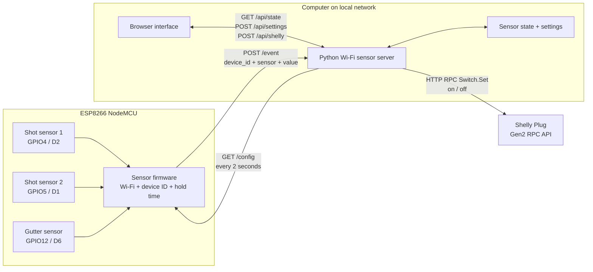

# Halloween Project Architecture

> The connected board is an ESP8266 NodeMCU-style board, although it was
> originally referred to as an ESP32.

## Sensor Flow

1. The ESP8266 samples all three sensors using internal pull-ups.
2. A sensor must remain changed for the configured `sensor_hold_ms` period.
3. The ESP8266 sends an HTTP `POST /event` event to the Python server.
4. Either shot sensor can start one made-shot sequence.
5. Both shot sensors must become inactive before another shot sequence can start.
6. The gutter sensor turns the Shelly plug off immediately.
7. The server's `drill_max_seconds` setting turns the plug off if no gutter event
   arrives first.

## Settings Flow

1. A user edits the drill timeout or sensor hold time in the browser.
2. The browser sends `POST /api/settings` to the Python server.
3. The server stores the settings in `server_config.json`.
4. The ESP8266 polls `GET /config` and applies the latest `sensor_hold_ms`
   value without requiring a firmware reflash.

## Device Registry

The server identifies an input by `device_id:sensor`, for example
`dispenser-1:shot1`. New inputs are registered automatically when their first
event arrives. The Settings tab stores a display name and role for each input,
and stores a name, address, and Shelly generation for each output.

## Shelly Control Flow

- A shot event causes the server to send `Switch.Set` with `on=true`.
- The server starts the drill maximum-time fallback timer.
- A gutter event cancels the fallback timer and sends `Switch.Set` with
  `on=false`.
- The press-and-hold `Dispense Candy` browser control sends Shelly on/off
  commands directly, with a safety timeout if the browser disconnects.

## Network Endpoints

| Component | Endpoint | Purpose |
| --- | --- | --- |
| ESP8266 -> server | `POST /event` | Sensor state events |
| ESP8266 <- server | `GET /config` | Sensor hold-time configuration |
| Browser -> server | `GET /api/state` | Current sensor and plug state |
| Browser -> server | `POST /api/settings` | Save drill and sensor settings |
| Browser -> server | `POST /api/shelly` | Manual Shelly control |
| Server -> Shelly | `GET /rpc/Switch.Set?id=0&on=...` | Turn plug on or off |
